# Звіт про виконання практичної роботи

## Налагоджувач VS Code: точка зупинки біля номера рядка, F5.
### Опис помилки №1. Область видимості (var \ let)

При var - налагоджувач показує, що змінна i потрапляє в область видимості всієї функції (Local: report). Вона є єдиною для всіх ітерацій, через що після закінчення циклу анонімні функції звертаються до вже неіснуючого індексу list[i] і викликають TypeError.

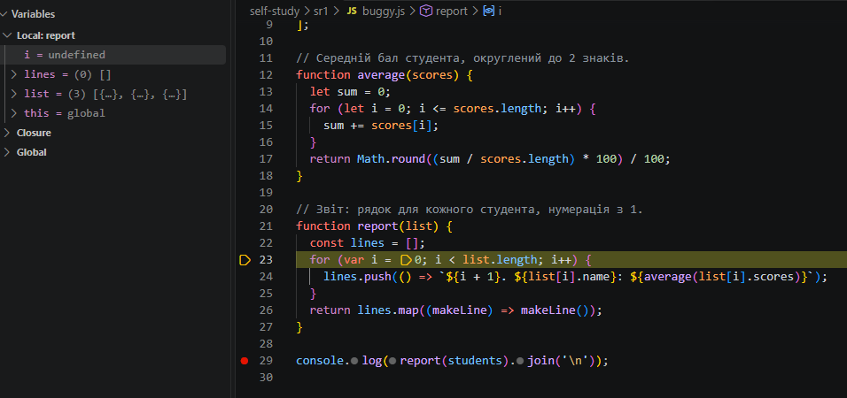

При let - створюється блочна область видимості (Block: report). Для кожної ітерації циклу зберігається власний контекст i, і код працює коректно.

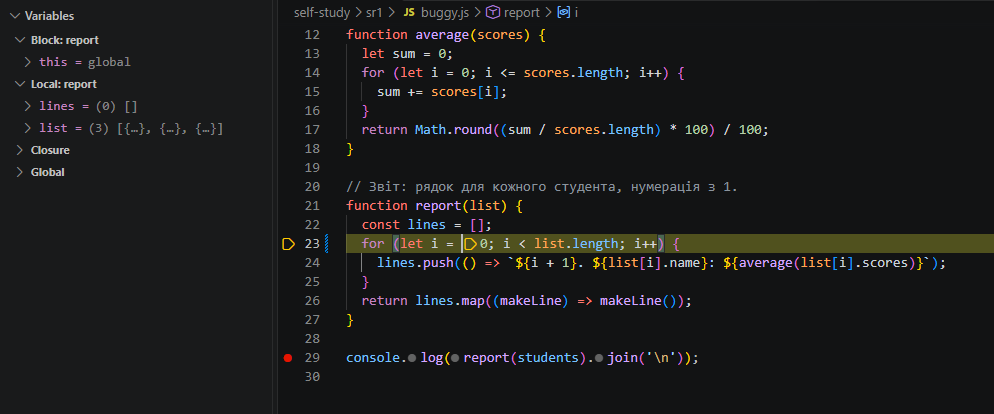

### Опис помилки №2 та №3. Умова циклу та типи даних у average

Проблема: через умову <= відбувався вихід за межі масиву, а через збереження оцінок як рядків замість чисел оператор + виконував склеювання тексту замість додавання

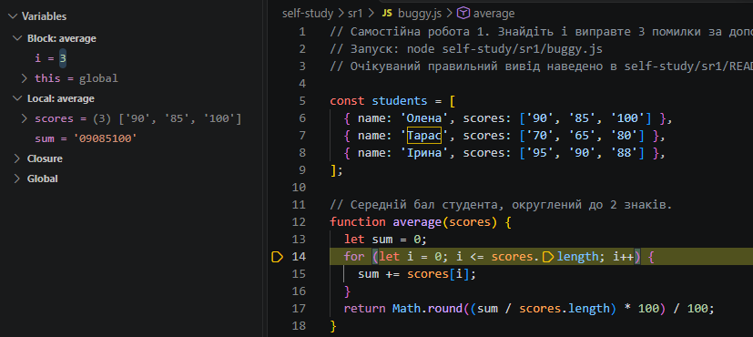

Рішення: змінено умову на строго менше ( < ) та додано приведення типів за допомогою Number()

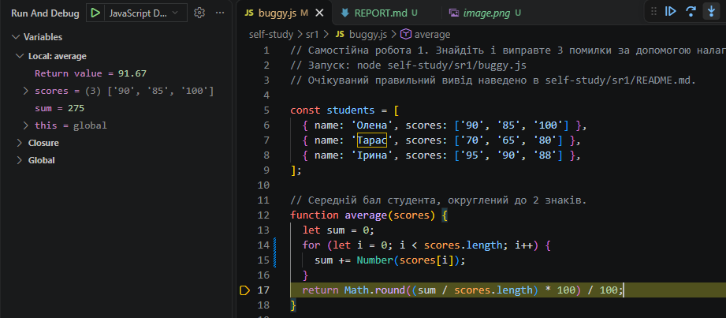

## Налагоджувач Chrome DevTools

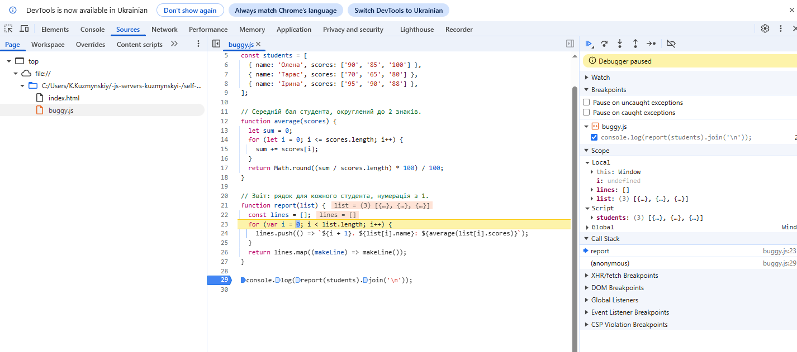

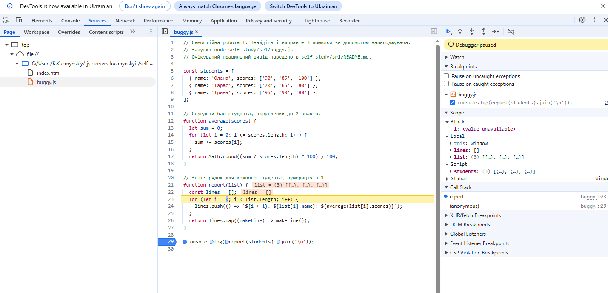

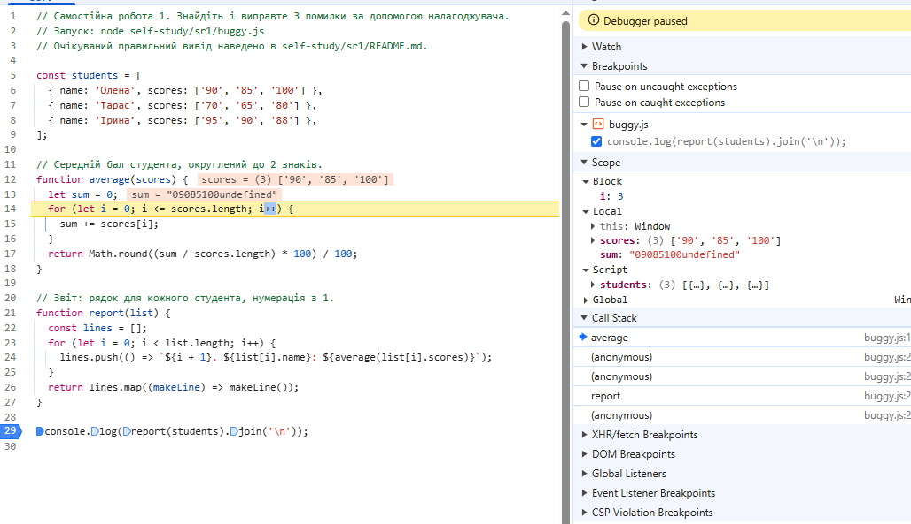

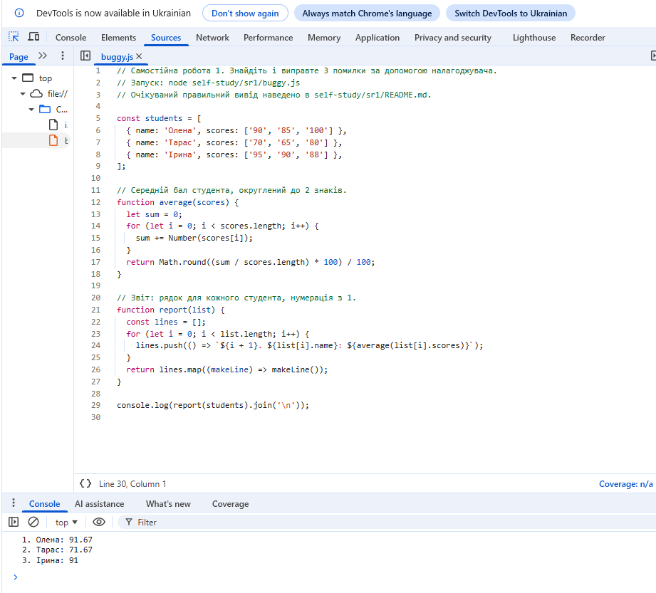

## Вбудований налагоджувач: node inspect
### Порівняльний аналіз var та let у node inspect

При var - після завершення циклу змінна i не зникає, а зберігається в області видимості функції зі значенням 3. Через це функції в масиві звертаються до неіснуючого елемента list[3] (undefined).

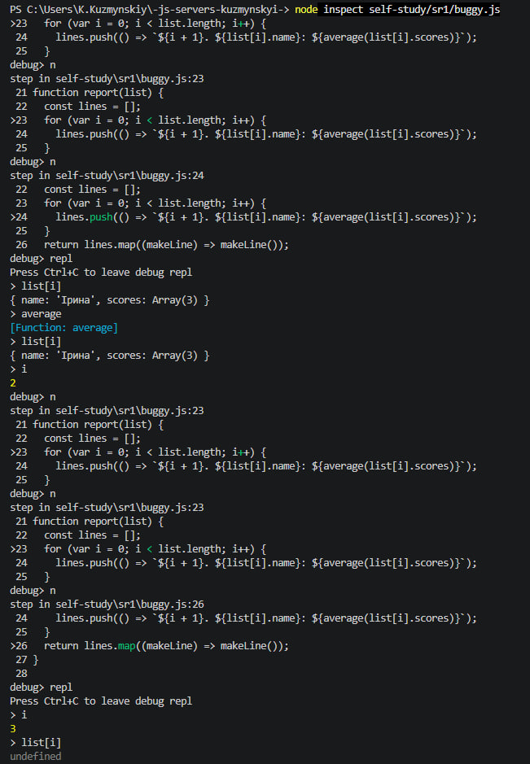

При let - змінна i існує виключно всередині блоку циклу. Після його завершення спроба звернутися до i викликає помилку ReferenceError: i is not defined, оскільки кожна ітерація зберегла власне ізольоване значення.

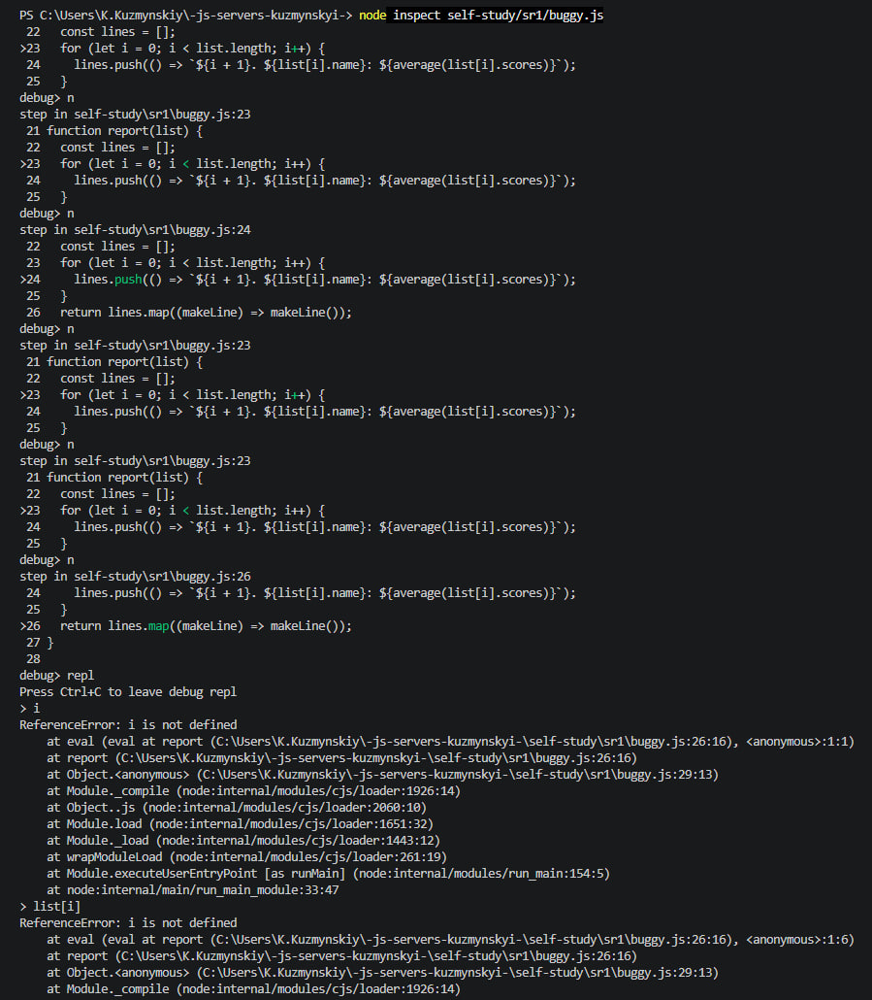

### Умова циклу та типи даних у average

Помилка:

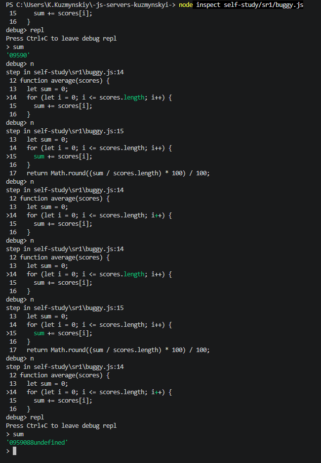

Виправлення:

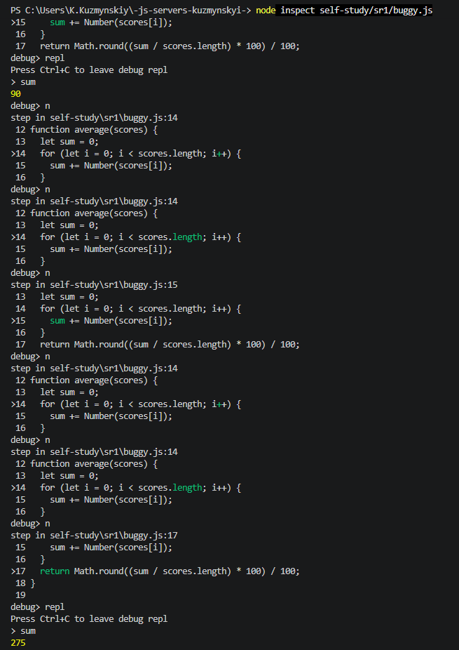

